# Prototypes

The three prototypes share the same content, systems and section order (`docs/DESIGN.md` §6). Only the theme (`themes/<id>`) differs, plus B's WebGL keyboard. Each one lives under its own prefix: `/a`, `/b`, `/c`, and the case studies under `/<id>/work/<slug>`. In dev, the switcher at the bottom left (or ⌘K → "Switch prototype") moves between them and keeps your place on the page.

Screenshots come from the production build at 1440 and 390 px and live in `docs/prototypes/<id>/`. Regenerate them with `node scripts/protoshots.mjs <id>` while `next start` is running.

## A: "Editor" (`/a`)

1. The whole site reads like a refined code editor: file-path labels, a `skills.json` panel, ⌘K, a gutter beside the bio and a status bar.
2. Violet → cyan accents on a dot-matrix background with a spotlight. A CSS 3D keyboard is the single focal point of the hero, and it reacts to typing.
3. It uses no WebGL and loads 125 KB of first-load JS, so it is fast on phones. The trade-off is that it leans the hardest on developer-tool motifs.

| Section | 1440 | 390 |
|---|---|---|
| Hero | 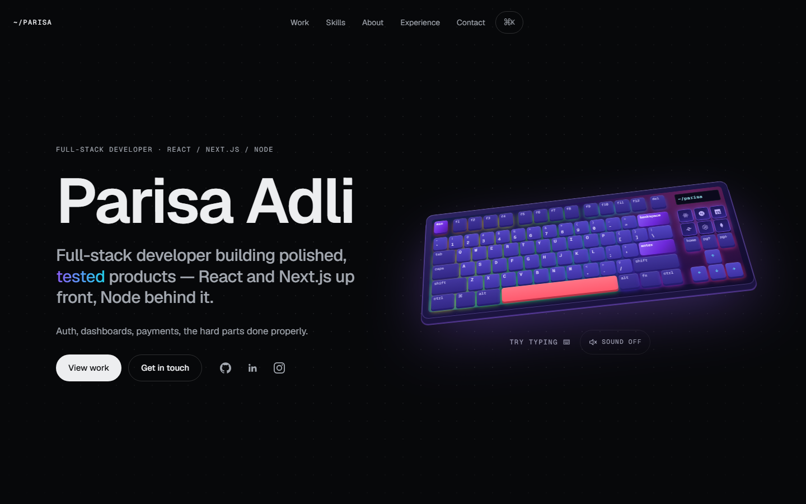 | 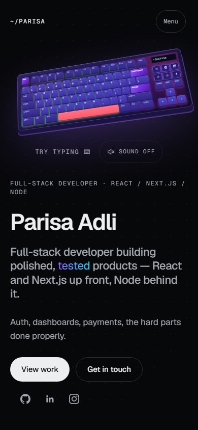 |
| Projects | 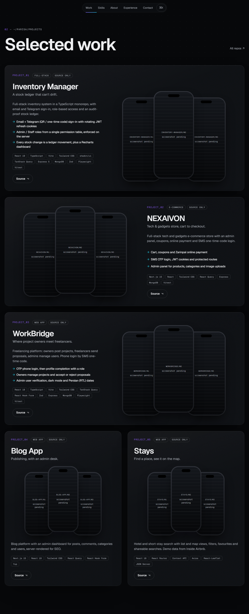 | 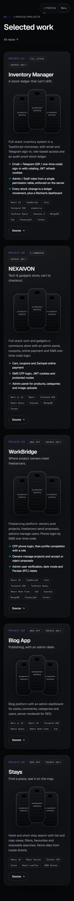 |
| Skills | 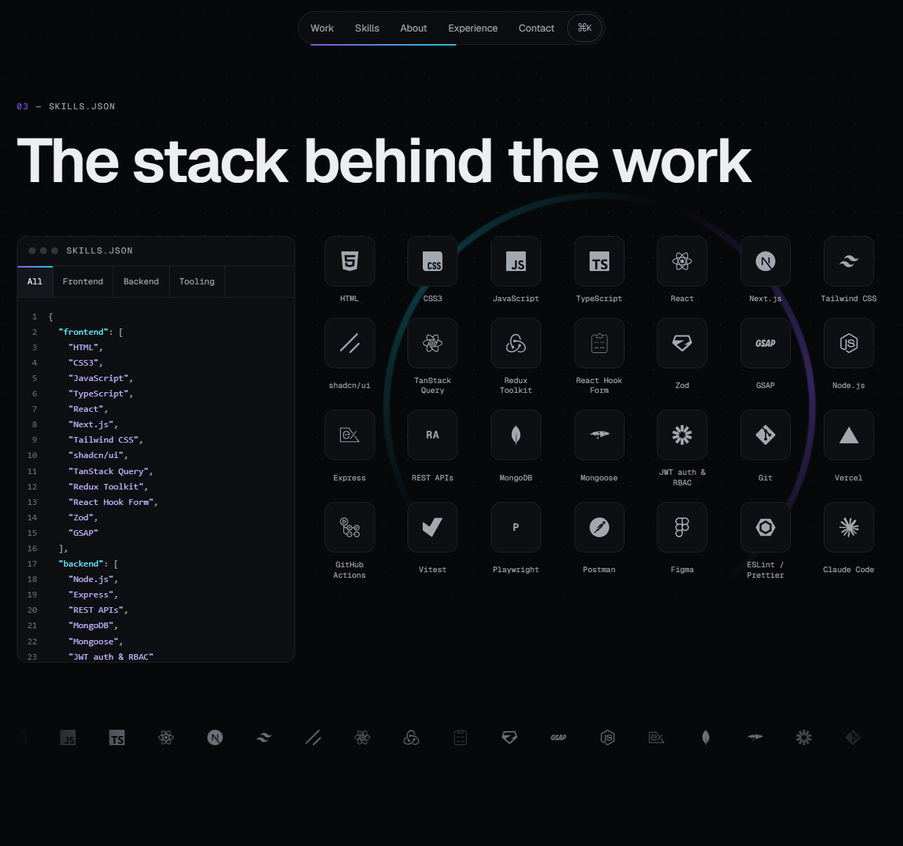 | 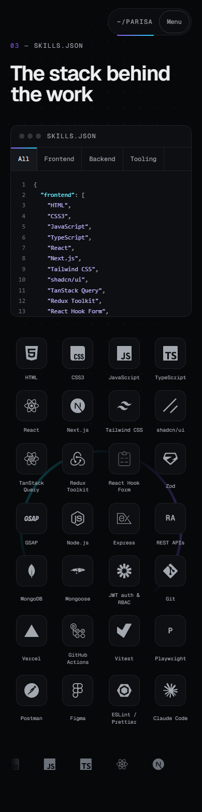 |

## B: "Mechanical" (`/b`)

1. Tactile and hardware-inspired: the keyboard is the star. It is a real 3D model built in code that matches the reference photos (purple acrylic, indigo caps, coral space bar, RGB light between the keys), with amber tech keys.
2. The rest of the site speaks the same keycap language: off-white keycap buttons that press in, bevelled cards and skill tiles, amber index keycaps and a caution-tape marquee, all set in Space Grotesk and JetBrains Mono.
3. It is the most memorable of the three, at a cost: 249 KB gzipped of three.js loads on the visitor's first interaction, behind a poster image of the same scene. First-load JS stays at 125 KB.

| Section | 1440 | 390 |
|---|---|---|
| Hero | 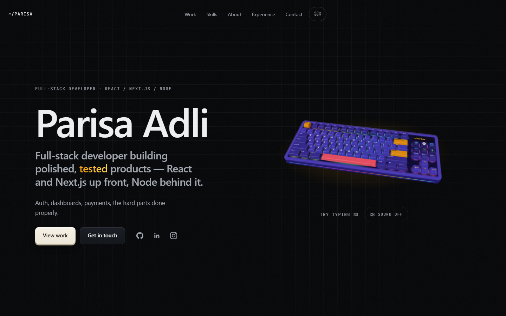 | 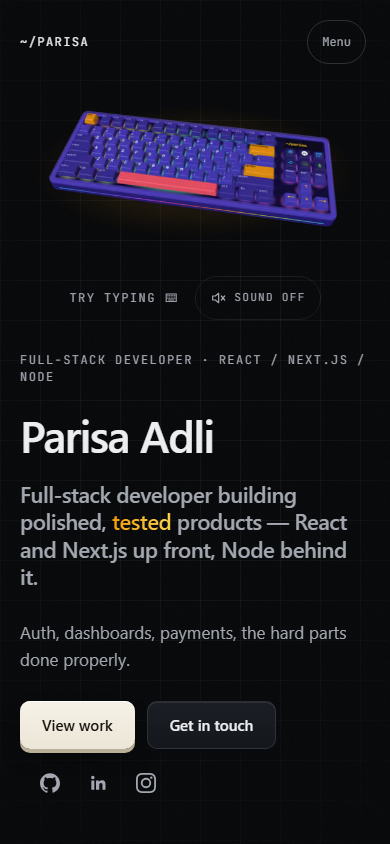 |
| Projects | 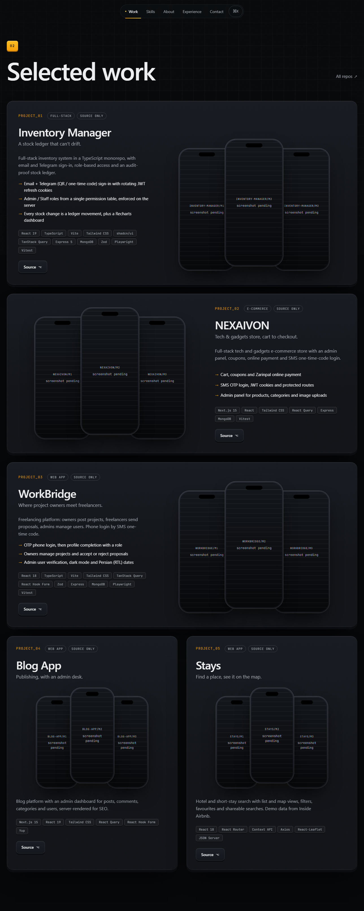 | 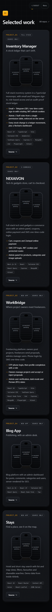 |
| Skills | 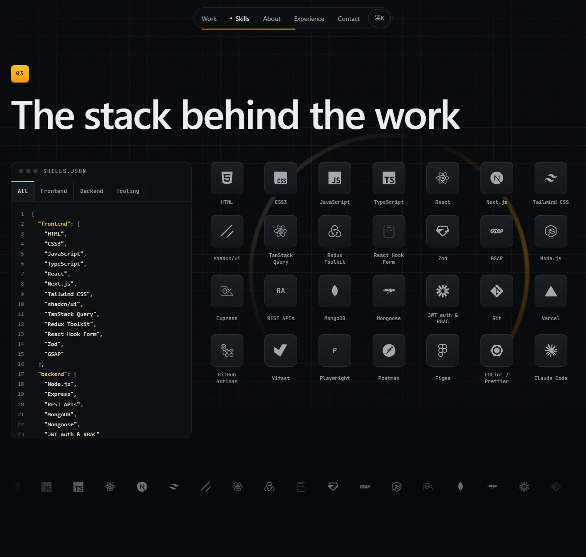 | 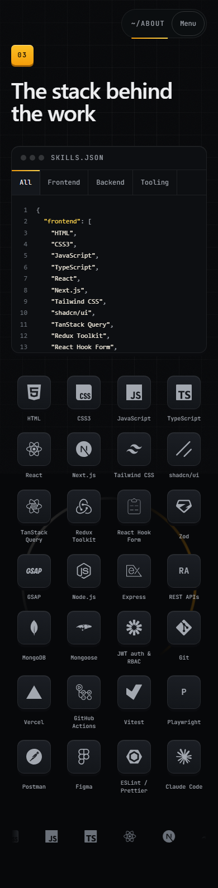 |

## C: "Editorial" (`/c`)

1. Minimal, typographic and gallery-like. The work carries the page: borderless cards with big serif-italic index numbers, and lots of black space.
2. Lime is the only colour, on near-black, set in Inter Tight with Instrument Serif italic for accents. The keyboard is an isometric line drawing whose keys light lime when pressed.
3. It has the lightest IDE motifs (mono labels and ⌘K) and the calmest feel. It is the most "has taste" of the three and the least "developer", and it shares A's no-WebGL performance.

| Section | 1440 | 390 |
|---|---|---|
| Hero | 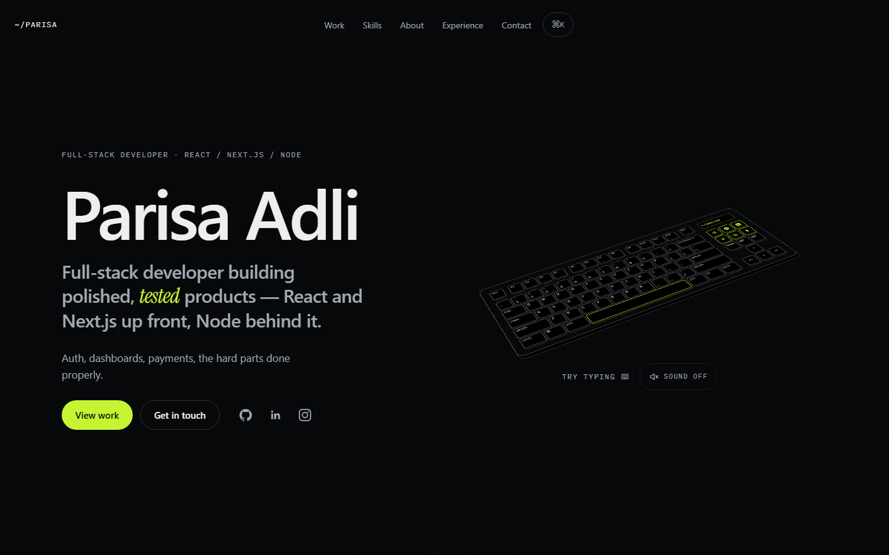 | 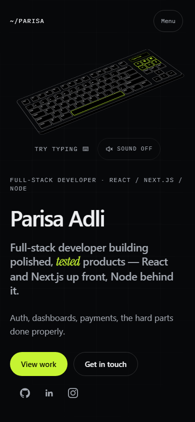 |
| Projects | 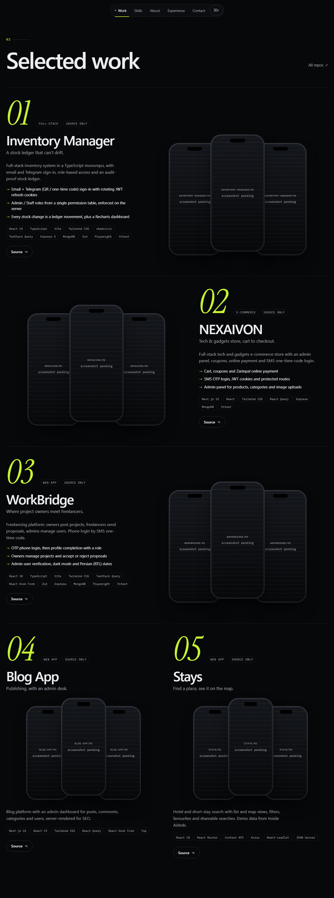 | 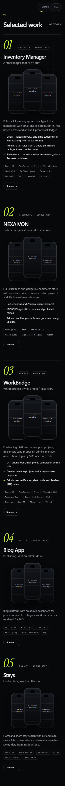 |
| Skills | 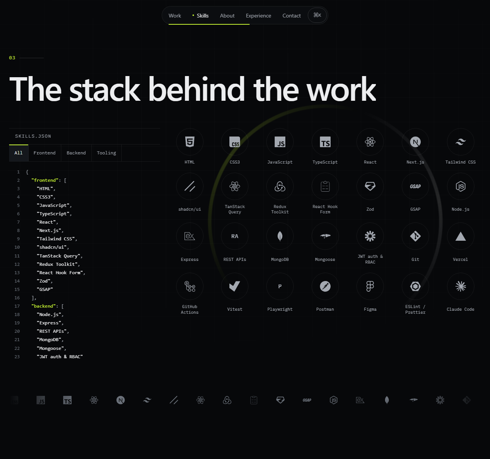 | 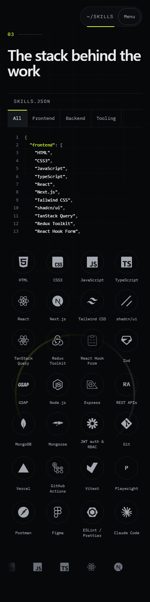 |

## §9 checks (production build, 2026-11-03)

| | A | B | C |
|---|---|---|---|
| Lighthouse mobile (Perf / A11y / BP / SEO) | 96 / 100 / 100 / 100 | 98 / 100 / 100 / 100 | 95 / 100 / 100 / 100 |
| LCP / CLS | 1.7 s / 0 | 1.7 s / 0.001 | 1.7 s / 0.001 |
| First-load JS | 125 KB | 125 KB (+ 249 KB gz lazy 3D) | 125 KB |
| INP approximation, 4× CPU (desktop / mobile) | 216 / – ms | 216 / 136 ms | 200 / 144 ms |
| axe (390, 1440, reduced motion) | 0 violations | 0 | 0 |
| Tab walk: 41 stops, all with a focus ring | ✓ | ✓ | ✓ |
| Reduced motion (no Lenis, cursor, float or tilt; fades only) | ✓ | ✓ | ✓ |
| Widths 390 / 768 / 1280 / 1440 / 1920, WebKit | ✓ | ✓ (WebGL works in WebKit) | ✓ |

Open: the desktop INP approximation is 200–216 ms on the skills-tab click in all three, so it comes from shared code (`SkillsFilter`). It was under 200 ms when A was finished, so this may be machine load. Re-measure on an idle machine, and fix it in `SkillsFilter` once a prototype is picked.
